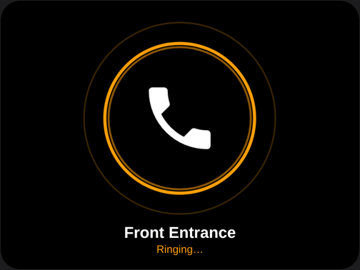
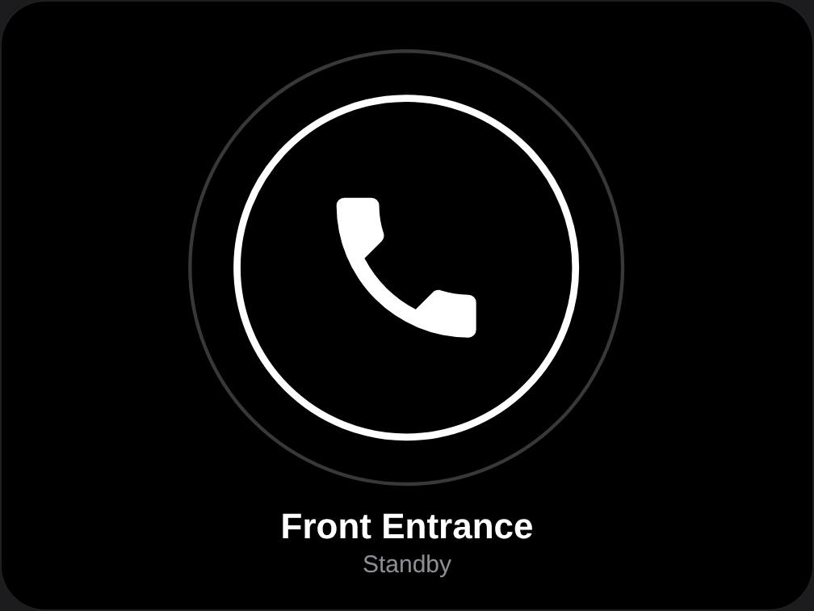
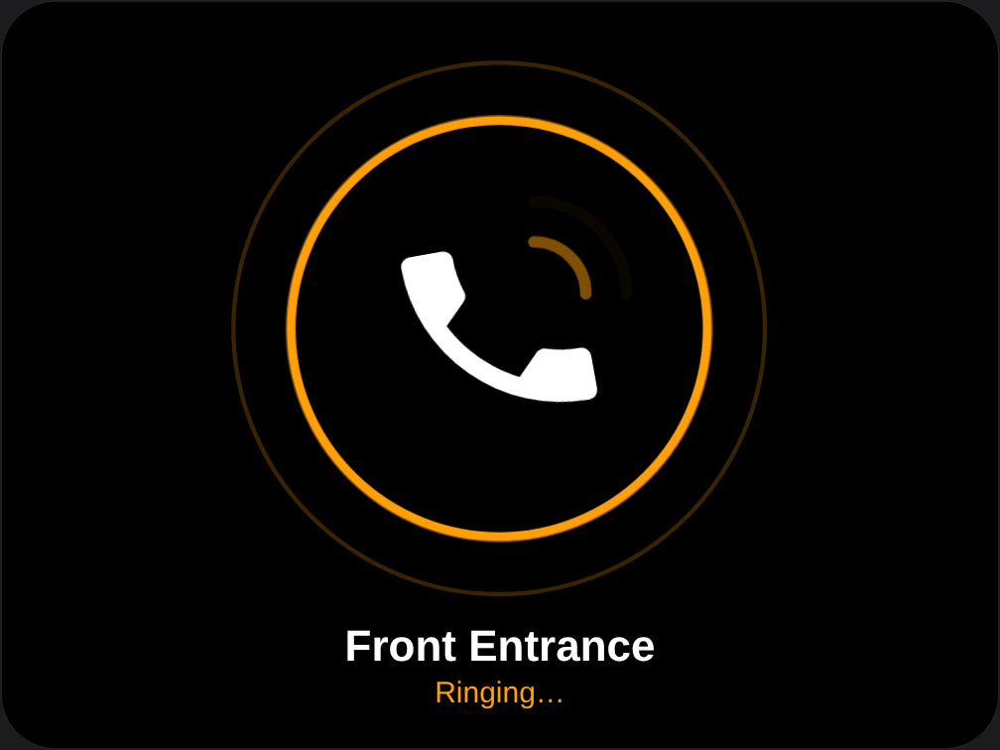
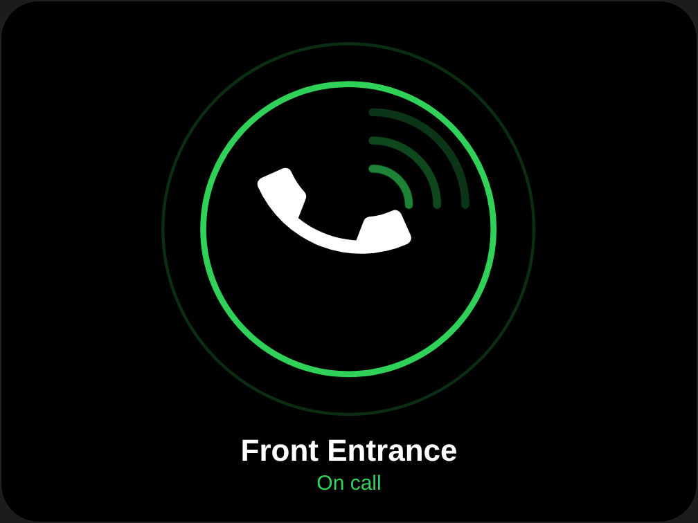
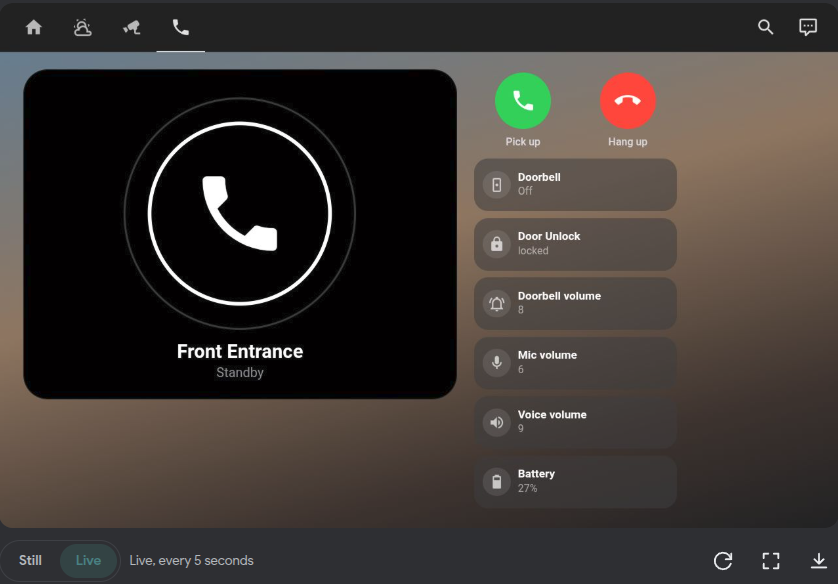
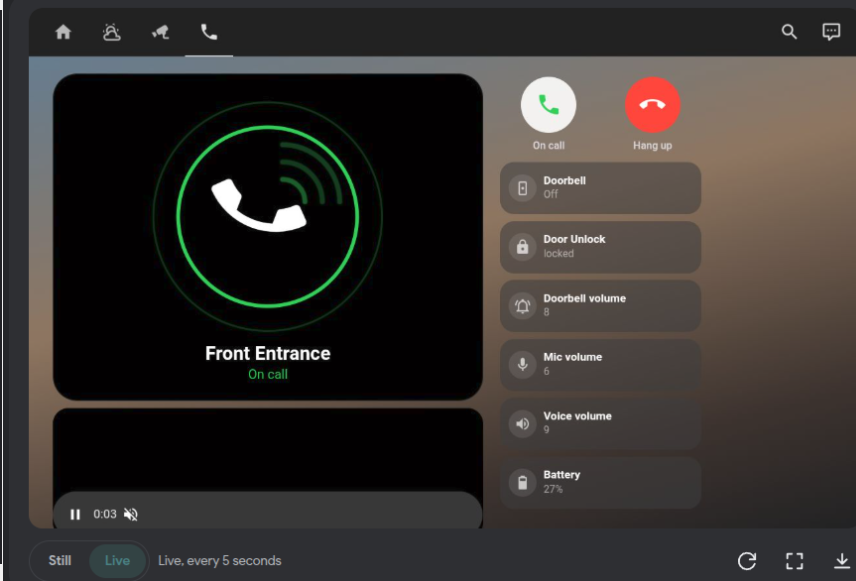
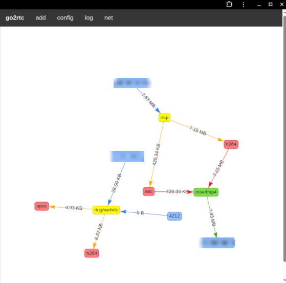

# Ring Intercom 2-way audio dashboard for Home Assistant

An Apple-Home-style wall-tablet screen for the **audio-only Ring Intercom**:
an animated phone that rings, **Pick up / Hang up** buttons with real
**2-way audio**, an **unlock** tile, and an automation that wakes your tablet and
jumps to the screen when someone rings.

> ## ⚠️ Status: beta / testing period
> This works on the author's setup (details below) but it has only been tested
> on **one** setup. Expect rough edges. **Testers and improvements are very
> welcome** - please open an issue or PR with what worked and what didn't on yours.

<p align="center">
  
</p>

| Standby | Ringing | On call |
|---|---|---|
|  |  |  |

*The three images above are preview renders of the animated card.*

### Real screenshots (author's Echo Show 8, Kiosk Satellite)

| Standby | On call (live 2-way audio) |
|---|---|
|  |  |

### go2rtc "net" graph during a call

The `ring/webrtc` node is the Ring Intercom producer. Audio flows in from Ring (opus) and out to
the browser, so this is the proof that the call is live. (IP addresses blurred.)



## What you get

- **Animated phone window** in three states: standby (static handset), ringing
  (shaking handset, pulsing arcs, orange), answered (lifted handset, calm green arcs).
- **Pick up / Hang up** round buttons. Pick up opens the Ring audio stream (speaker + mic);
  Hang up closes it again.
- **Tiles:** doorbell indicator, **Door Unlock** (tap the icon), doorbell / mic / voice volume,
  intercom battery.
- **Automation:** on a ring, wake the tablet, open the Intercom view, and return to the home
  view after 2 minutes if nobody picks up.
- **Safety net automation:** auto hang-up after 2 minutes so a forgotten call can't keep the
  intercom awake and drain its battery.

## How it works

```
Ring Intercom ──(Ring cloud, WebRTC)──▶ go2rtc "ring" source ──▶ webrtc-camera card (in the dashboard)
                                                                         ▲
   Pick up button ─▶ input_boolean.intercom_answered = on ───────────────┘
        (the card only exists while the helper is on, so the stream only runs during a call)
   ring (ding sensor) ─▶ automation ─▶ tablet wakes + opens the Intercom view
```

The key trick: the stream card sits inside a `conditional` card that depends on a
single helper toggle. **No toggle = no card = no stream = the intercom stays asleep.**

## Tested on (author's setup)

- Ring Intercom, **audio-only (battery) model**
- Home Assistant OS with the **go2rtc add-on 1.9.14**
- HACS frontend cards: `button-card`, `layout-card`, `WebRTC Camera` (latest as of October 2026)
- Ring events from **ring-mqtt** (`binary_sensor.<name>_ding`); the official Ring integration is also installed
- Wall tablet: Echo Show 8 running **Kiosk Satellite** (the tablet part of the automation is specific to this)
- Browser mic on the tablet works through Kiosk Satellite; on a PC the microphone needs **HTTPS**

If you try it on something else (other intercom model, Fully Kiosk, a phone, etc.) please report back.

## Requirements

1. Home Assistant with the **go2rtc add-on** (or a standalone go2rtc) in a version that includes the **Ring source** (the author used add-on 1.9.14)
2. HACS frontend cards: [button-card](https://github.com/custom-cards/button-card),
   [layout-card](https://github.com/thomasloven/lovelace-layout-card),
   [WebRTC Camera](https://github.com/AlexxIT/WebRTC)
3. Ring events in Home Assistant: [ring-mqtt](https://github.com/tsightler/ring-mqtt) and/or the official Ring integration
4. Node.js on any computer (only to create the Ring token once)

## Setup

### 1. Get a Ring refresh token (there is no API key)

Ring does not offer a normal API key or developer portal for this. What go2rtc (and ring-mqtt,
and the official integration) use is an **OAuth refresh token** for your Ring account, created
by the unofficial [`ring-client-api`](https://github.com/dgreif/ring) tooling. You create it once
on any computer that has Node.js:

```bash
npx -y -p ring-client-api@latest ring-auth-cli
```

1. Enter your **Ring e-mail and password**.
2. Enter the **2FA code** Ring sends you (SMS / authenticator app).
3. The tool prints a long string called the **refresh token**. Copy it somewhere safe.

Things to know:
- The token is as powerful as your Ring login. **Never commit it, post it, or paste it into screenshots.**
- Each integration should have its **own** token. The token shows up in Ring's *Control Center →
  Authorized Client Devices* (go2rtc appears as `ring-client-go`), where you can revoke it.
- Tokens are effectively **single use**: Ring rotates them. If you paste a token into go2rtc's
  web "Add → Ring" page, it is **consumed** and the same token will later fail with
  `401 invalid_grant`.
- go2rtc's own web login can fail with `406 Not Acceptable`. Creating the token with
  `ring-auth-cli` as above avoids that.

### 2. Find your intercom's `camera_id` and `device_id`

The go2rtc Ring source needs three values. The two IDs are listed by go2rtc itself:

1. Open go2rtc's web UI → **Add → Ring**, paste the refresh token from step 1 and log in.
2. It lists your Ring devices. Note the **camera id** and **device id** of your Intercom
   (the generated `ring:?camera_id=…&device_id=…` link shows both).
3. Because that page used up the token, run `ring-auth-cli` **again** to create a **fresh** token
   for the real configuration.

### 3. Add the stream to go2rtc

Copy `go2rtc/go2rtc.yaml.example` into your go2rtc configuration and fill in the three
placeholders with the **fresh** token and the two IDs. All three values are required; no quotes;
write a trailing `==` in the token as `%3D%3D`. Restart go2rtc.
**Do not add the stream to `preload:`.**

### 4. Create the helper

Create a toggle helper whose entity id is **`input_boolean.intercom_answered`**
(see `helpers/input_boolean.yaml`).

### 5. Add the dashboard

1. Create a new dashboard (or use an existing one).
2. Three dots → **Raw configuration editor**.
3. Paste `dashboard/intercom-dashboard.yaml`. If you already have a dashboard, merge the
   `button_card_templates:` block and add the view under your `views:`.
4. Replace the entity ids (table below).

### 6. Add the automations

Create automations from `automations/*.yaml` (Settings → Automations → ⋮ → *Edit in YAML*).
Edit the lines marked `# <-- CHANGE` and adapt the tablet actions to your kiosk app.

### Entity ids to replace

| In the files | Replace with |
|---|---|
| `binary_sensor.front_entrance_ding` | your intercom's ding sensor |
| `lock.front_entrance_lock` | your intercom's lock |
| `number.front_entrance_doorbell_volume` / `_mic_volume` / `_voice_volume` | the volume number entities (delete the tile if your intercom doesn't have them) |
| `sensor.front_entrance_battery` | the intercom battery sensor |
| `input_boolean.intercom_answered` | keep as is (or rename everywhere) |
| `ring-intercom` | the stream name in your go2rtc config |
| `light.echo_show_screen`, `switch.echo_show_hold_mode`, `select.echo_show_dashboard_view` | your tablet's entities |

## Testing without a real ring

- **Answered state:** toggle `input_boolean.intercom_answered` in Developer Tools → States or press Pick up.
- **Ringing state:** in Developer Tools → States set your ding sensor to `on` (the real sensor flips back by itself).
- **Automation:** Settings → Automations → your automation → ⋮ → *Run actions*.

## Known issues / gotchas

- **Ring tokens are fragile.** Single use; one token per integration; manage devices in
  Ring Control Center → Authorized Client Devices.
- **go2rtc's own web pages can wake the intercom.** Opening `/api/streams?src=ring-intercom`
  or a stream's info page creates a *probe* connection that opens a live session and keeps
  the intercom's LED on. Use plain `/api/streams` for diagnosis and close those tabs.
- **Never use `background: true`** on the stream card, and don't `preload` the stream - both
  keep the live session open after hang-up.
- **An open live session drains the battery** (and can make the intercom ignore a new ring).
- **Ding sensors can miss rings** (for example when the handset is off the hook). The
  automation example shows how to add a second trigger.
- **Mic permissions:** browsers only allow the microphone over HTTPS. Kiosk Satellite grants it on its own.
- **Feedback squeal:** tablet speaker + intercom mic can loop. Lower the volumes.
- The tablet automation is **Kiosk Satellite specific**; other kiosk apps need different actions.
- `call-auto-hangup.yaml` is a simple safety automation that has not been tested separately by the author.

See [docs/troubleshooting.md](docs/troubleshooting.md) for the error messages you'll meet and what they mean.

## Security

- Never commit or paste your refresh token, passwords, camera/device IDs or public hostnames.
  `go2rtc/go2rtc.yaml.example` only contains placeholders.
- The dashboard contains an **unlock button**. Put it only on dashboards that need it and protect
  your Home Assistant login (2FA). Don't expose go2rtc's port to the internet.
- This project talks to Ring through go2rtc's **unofficial** Ring source. It is not affiliated
  with or endorsed by Ring or Amazon, can break at any time, and you use it at your own risk.

## Roadmap / ideas

- Package the animated phone as its own **custom card** (this would also make it installable via HACS).
- Other kiosk apps (Fully Kiosk, browser_mod, companion app) for the wake-and-navigate part.
- Optional chime / spoken announcement on a ring.
- SIP / VoIP bridge so you can answer from a desk phone.
- A push-to-talk mode instead of an always-open mic.

## Contributing

Issues and PRs welcome - especially: working configs for other tablets, other Ring Intercom
models, entity-id differences you hit, and better ways to detect a ring.

## Credits

- Handset icon path from [Material Design Icons](https://pictogrammers.com/library/mdi/) (Apache-2.0).
- Built on [go2rtc](https://github.com/AlexxIT/go2rtc), [WebRTC Camera](https://github.com/AlexxIT/WebRTC),
  [button-card](https://github.com/custom-cards/button-card), [layout-card](https://github.com/thomasloven/lovelace-layout-card),
  [ring-client-api](https://github.com/dgreif/ring) and [ring-mqtt](https://github.com/tsightler/ring-mqtt).

## License

MIT - see [LICENSE](LICENSE).
